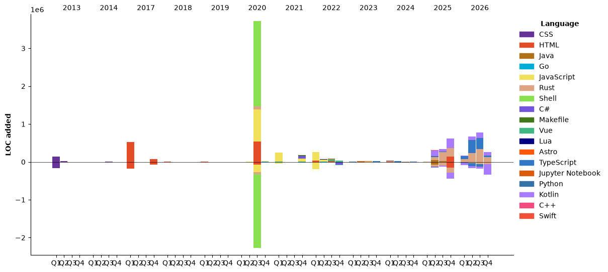

### Hi there 👋

🌱 As a full-stack developer, I have expertise in front-end and back-end development technologies. My skill set includes proficiency in HTML5, CSS3, JavaScript, TypeScript, React, Vue3, Node.js, Java, Spring, Golang, Rust, and various databases such as MongoDB, MySQL, and PostgreSQL. I have a strong understanding of software development methodologies and have a proven track record of delivering high-quality, scalable, and efficient applications. With excellent problem-solving skills and attention to detail, I can rapidly adapt to new technologies and projects. I am passionate about creating user-friendly and visually appealing web applications that meet business requirements and deliver a great user experience.

[](https://github.com/ryo-ma/github-profile-trophy)

<!--START_SECTION:waka-->


**🐱 My GitHub Data** 

> 📦 ? Used in GitHub's Storage 
 > 
> 🏆 94 Contributions in the Year 2026
 > 
> 💼 Opted to Hire
 > 
> 📜 137 Public Repositories 
 > 
> 🔑 0 Private Repositories 
 > 
**I'm an Early 🐤** 

```text
🌞 Morning                2570 commits        ███████░░░░░░░░░░░░░░░░░░   27.67 % 
🌆 Daytime                4039 commits        ███████████░░░░░░░░░░░░░░   43.48 % 
🌃 Evening                2453 commits        ███████░░░░░░░░░░░░░░░░░░   26.41 % 
🌙 Night                  227 commits         █░░░░░░░░░░░░░░░░░░░░░░░░   02.44 % 
```
📅 **I'm Most Productive on Monday** 

```text
Monday                   1788 commits        █████░░░░░░░░░░░░░░░░░░░░   19.25 % 
Tuesday                  1738 commits        █████░░░░░░░░░░░░░░░░░░░░   18.71 % 
Wednesday                1506 commits        ████░░░░░░░░░░░░░░░░░░░░░   16.21 % 
Thursday                 1408 commits        ████░░░░░░░░░░░░░░░░░░░░░   15.16 % 
Friday                   1160 commits        ███░░░░░░░░░░░░░░░░░░░░░░   12.49 % 
Saturday                 709 commits         ██░░░░░░░░░░░░░░░░░░░░░░░   07.63 % 
Sunday                   980 commits         ███░░░░░░░░░░░░░░░░░░░░░░   10.55 % 
```


📊 **This Week I Spent My Time On** 

```text
🕑︎ Time Zone: Asia/Shanghai

💬 Programming Languages: 
TypeScript               9 hrs 21 mins       ██████████░░░░░░░░░░░░░░░   39.17 % 
Astro                    4 hrs 59 mins       █████░░░░░░░░░░░░░░░░░░░░   20.93 % 
Markdown                 2 hrs 45 mins       ███░░░░░░░░░░░░░░░░░░░░░░   11.57 % 
JSON                     1 hr 20 mins        █░░░░░░░░░░░░░░░░░░░░░░░░   05.65 % 
XML                      1 hr 3 mins         █░░░░░░░░░░░░░░░░░░░░░░░░   04.43 % 

🔥 Editors: 
Claude Code              23 hrs 1 min        ████████████████████████░   96.40 % 
IntelliJ IDEA            39 mins             █░░░░░░░░░░░░░░░░░░░░░░░░   02.74 % 
VS Code                  12 mins             ░░░░░░░░░░░░░░░░░░░░░░░░░   00.86 % 

🐱‍💻 Projects: 
ut-match.com             17 hrs 13 mins      ██████████████████░░░░░░░   72.10 % 
promichi-be              2 hrs 29 mins       ███░░░░░░░░░░░░░░░░░░░░░░   10.45 % 
promichi                 1 hr                █░░░░░░░░░░░░░░░░░░░░░░░░   04.22 % 
eltonzheng.me            1 hr                █░░░░░░░░░░░░░░░░░░░░░░░░   04.22 % 
promichi-fe-react        37 mins             █░░░░░░░░░░░░░░░░░░░░░░░░   02.63 % 

💻 Operating System: 
Mac                      23 hrs 52 mins      █████████████████████████   100.00 % 
```

🤖 **AI Coding This Week** 

```text
⏱ AI Coding Time: 23 hrs 36 mins (98.84%)

✍️ 15,032 lines written by AI, 0 lines written by hand (100.0% AI-written)

🔤 14,449,374 Input Tokens, 3,379,213 Output Tokens

💵 $328.75 Estimated AI Cost This Week

🧠 63 AI Sessions, 410 AI Prompts

Opus                     17,776 lines        █████████████████████████   100.00 % 
Sonnet                   0 lines             ░░░░░░░░░░░░░░░░░░░░░░░░░   00.00 % 

🔎 AI Coding Insights:
🤖 AI-Driven — 100.0% of written lines came from AI
📄 Detailed Prompter — average 1,388 characters per prompt
🔁 Iterative Prompter — average 7 prompts per session
🚀 High AI Trust — 0.01% of changed lines were hand-edited
```

**I Mostly Code in JavaScript** 

```text
Rust                     25 repos            ████░░░░░░░░░░░░░░░░░░░░░   17.61 % 
TypeScript               16 repos            ███░░░░░░░░░░░░░░░░░░░░░░   11.27 % 
Python                   8 repos             █░░░░░░░░░░░░░░░░░░░░░░░░   05.63 % 
Kotlin                   3 repos             █░░░░░░░░░░░░░░░░░░░░░░░░   02.11 % 
Swift                    1 repo              ░░░░░░░░░░░░░░░░░░░░░░░░░   00.70 % 
```


**Timeline**




 Last Updated on 01/11/2026 08:36:50 UTC
<!--END_SECTION:waka-->

<!--
**elton/elton** is a ✨ _special_ ✨ repository because its `README.md` (this file) appears on your GitHub profile.

Here are some ideas to get you started:

- 🔭 I’m currently working on ...
- 🌱 I’m currently learning ...
- 👯 I’m looking to collaborate on ...
- 🤔 I’m looking for help with ...
- 💬 Ask me about ...
- 📫 How to reach me: ...
- 😄 Pronouns: ...
- ⚡ Fun fact: ...
-->
